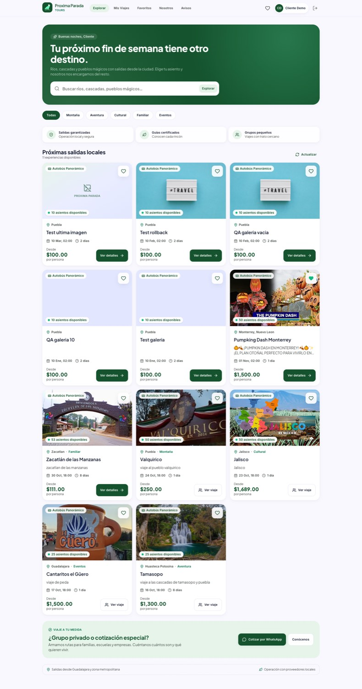

# Proxima Parada Tours — Web

Aplicación web (SPA) para operar la agencia de turismo **Proxima Parada Tours**: catálogo y reserva de viajes para clientes, más back-office para administradores y coordinadores.

Construida con **React 19 + TypeScript + Vite + Tailwind CSS v4**, siguiendo el sistema de diseño de `DESIGN.md` y la especificación funcional `docs/web-rebuild-spec.md` del repositorio móvil original (.NET MAUI).



## Qué incluye

### Experiencia de cliente

- **Autenticación:** inicio de sesión, registro, sesión en `sessionStorage`, guards por rol y cierre de sesión.
- **Explorar:** búsqueda, filtros por categoría, favoritos, tarjetas de viaje con disponibilidad, precio, transporte y fechas.
- **Detalle del viaje:** descripción, itinerario, POIs, opciones con precios y beneficios, selección de adultos/niños, necesidades especiales, calendario `.ics`, mapa y solicitud de cupo.
- **Checkout:** mapa de asientos por piso, pasajeros y edades, códigos de descuento, uso de saldo a favor, aceptación de políticas en dos pasos y creación de reserva.
- **Mis viajes:** filtros por estado, búsqueda, saldo, avisos de vencimiento y acceso al detalle.
- **Detalle de reserva:** QR del titular, acompañantes, pagos, aplicación de saldo, calificación, cancelación total/parcial con política de reembolso.
- **QR de acompañantes**, alta de acompañantes y calificación del viaje.
- **Mi perfil:** pase digital con QR, saldo, movimientos, solicitud de reembolso, edición de datos y preferencias.
- **Avisos:** agrupados por día y clasificados por tipo.
- **Nosotros:** página de marca y compromisos.

### Back-office

- **Viajes:** listado, pausar/reactivar, crear/editar con hotel, dos pisos, fechas, precios y publicación de imagen.
- **Detalle del viaje:** KPIs, pasajeros, solicitudes de cupo, opciones, unidad de transporte, opiniones, finalizar/reabrir y eliminación.
- **Reservas y pagos:** filtros, búsqueda, registro de pagos manuales, confirmación, cancelación y cancelación de boletos.
- **Check-in:** apertura/cierre, marcado de salida, abordaje del titular y acompañantes, QR y escaneo con cámara (`jsQR`) con verificación manual de respaldo.
- **Mapa de asientos** con detalle de ocupación y check-in.
- **Opciones, asientos, ruta/POIs, estadísticas, coordinadores, descuentos, reembolsos, gastos y auditoría.**

## Stack

| Área | Tecnología |
|---|---|
| Build | Vite 7, TypeScript estricto |
| UI | React 19, Tailwind CSS 4, Lucide |
| Router | React Router 7 |
| Datos | TanStack Query 5 |
| Formularios | React Hook Form + Zod |
| Fechas | date-fns + date-fns-tz (`America/Mexico_City`) |
| Dinero | `decimal.js` (nunca aritmética flotante para importes) |
| QR | `qrcode.react` |
| Escaneo | `jsqr` + `getUserMedia` |
| Mapas | Leaflet + OpenStreetMap |
| Tests | Vitest + Testing Library |

## Cómo empezar

Requisitos: Node 20+ y npm.

```bash
npm install
npm run dev
```

La app queda en `http://localhost:5173`. En desarrollo, Vite hace proxy de `/api` hacia la API configurada en `VITE_API_PROXY_TARGET` (por defecto la API de Railway). No se necesita configurar CORS en local.

### Variables de entorno

Copia `.env.example` a `.env` y ajusta:

```env
# Déjalo vacío si usas el proxy de Vite o si la API vive en el mismo origen.
VITE_API_BASE_URL=
# Destino del proxy de desarrollo.
VITE_API_PROXY_TARGET=https://travelagency-production-f6cf.up.railway.app
```

Para producción con otro dominio, configura `VITE_API_BASE_URL` y habilita CORS en la API, o publica la SPA bajo el mismo origen que la API.

### Cuentas demo (solo desarrollo)

El bloque **Acceso rápido de pruebas** del login solo aparece en modo desarrollo:

| Rol | Correo | Contraseña |
|---|---|---|
| Admin | `admin@travelagency.com` | `Admin123!` |
| Cliente | `cliente@travelagency.com` | `Cliente123!` |

## Scripts

```bash
npm run dev       # servidor de desarrollo
npm run build     # typecheck + build de producción
npm run preview   # sirve el build
npm run test      # suite de Vitest
npm run test:watch
```

## Estructura

```text
src/
  app/                 # App, router, guards, providers, query client
  features/
    auth/              # login, sesión, schemas, guards
    trips/             # catálogo, detalle, mapa, checkout de viaje
    bookings/          # checkout, mis viajes, detalle, QR, acompañantes
    favorites/
    notifications/
    profile/           # perfil, wallet, payouts
    company/           # Nosotros
    staff/             # back-office completo
  shared/
    api/               # cliente HTTP, errores y tipos del contrato
    components/        # UI, layout, mapa, asientos, feedback
    hooks/
    lib/               # dinero, fechas, ICS, política de reembolso, teléfono
    styles/            # tokens del sistema de diseño + estilos globales
```

## Decisiones de implementación

- **El backend es la autoridad.** El frontend oculta acciones no permitidas, pero todos los permisos, precios, cupos y reembolsos se validan en la API.
- **Fechas:** la API entrega UTC; la UI presenta y captura en `America/Mexico_City`. Los formularios convierten en ambos sentidos.
- **Dinero:** se manejan strings/decimales con `decimal.js` y se formatean con `Intl.NumberFormat("es-MX")`.
- **Sesión:** JWT en `sessionStorage`; ante un `401` se limpia la sesión y se redirige al login. No se guardan contraseñas.
- **Canonizaciones aplicadas:** estados en español, propiedad de la cancelación según quién la hizo, QR oculto en reservas canceladas, pago manual sin método “Wallet”, y cálculo del checkout con las opciones seleccionadas.
- **Inconsistencias conocidas del backend** (documentadas en la especificación) se señalan en la UI cuando afectan al staff, por ejemplo: la cancelación administrativa no genera reembolso automático a la wallet.
- **Escaneo QR:** usa `BarcodeDetector`/cámara mediante `jsQR`; si el navegador o el permiso fallan, siempre queda la verificación manual por token.
- **Mapas:** Leaflet con tiles de OpenStreetMap; la búsqueda de lugares usa Nominatim y tiene fallback a marcado manual.

## Rutas principales

| Ruta | Rol | Pantalla |
|---|---|---|
| `/login` | Público | Login / registro |
| `/explore` | Cliente | Catálogo |
| `/trips/:id` | Cliente | Detalle del viaje |
| `/trips/:id/book` | Cliente | Checkout |
| `/bookings` | Cliente | Mis viajes |
| `/bookings/:id` | Cliente | Detalle de reserva |
| `/bookings/:id/qr` | Cliente | QR de acompañantes |
| `/profile` | Cliente | Perfil, wallet y pase |
| `/notifications` | Cliente | Avisos |
| `/staff/trips` | Staff | Viajes |
| `/staff/trips/:id` | Staff | Detalle operativo |
| `/staff/bookings` | Admin | Reservas |
| `/staff/trips/:id/checkin` | Admin | Check-in y salida |
| `/staff/trips/:id/scan` | Admin | Escaneo QR |
| `/staff/stats` | Admin | Estadísticas |
| `/staff/coordinators` | Admin | Coordinadores |
| `/staff/discounts` | Admin | Descuentos |
| `/staff/payouts` | Admin | Reembolsos |
| `/staff/expenses` | Admin | Gastos |
| `/staff/audit` | Admin | Auditoría |

## Pruebas

```bash
npm run test
```

La suite cubre política de reembolso, saldos, redondeo monetario, fechas UTC/locales, validación de autenticación y cálculo de cupo/precio.

## Estado y siguientes pasos

Implementado el flujo completo de cliente y el back-office operativo. Pendientes naturales para una siguiente iteración:

- OAuth real con Supabase (hoy los botones sociales muestran un aviso de “próximamente”).
- Persistencia de la aceptación de políticas en servidor.
- Pago con pasarela (hoy el pago es manual o con saldo).
- Descarga del pase como PNG y Apple/Google Wallet.
- Pruebas E2E automatizadas con Playwright y pruebas de integración contra la API.
- Endpoint de cotización en backend para eliminar el último cálculo de precio en cliente.

## Créditos

Diseño y producto: Proxima Parada Tours. Especificación funcional y sistema de diseño: repositorio original (`docs/web-rebuild-spec.md`, `DESIGN.md`).
